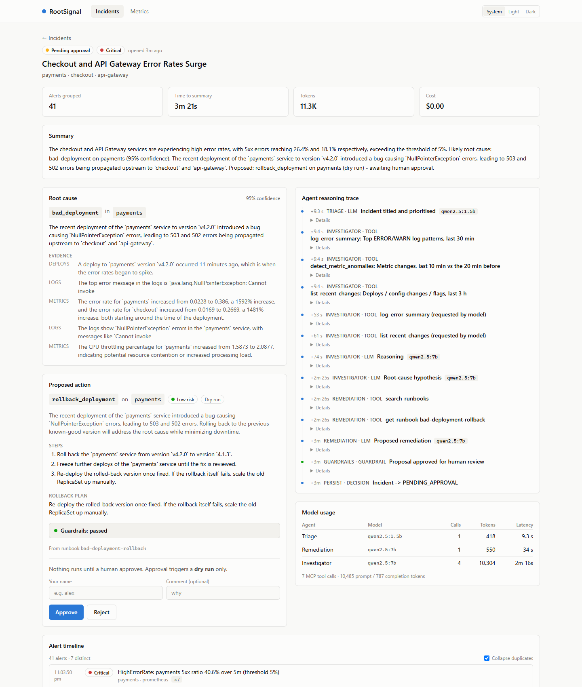
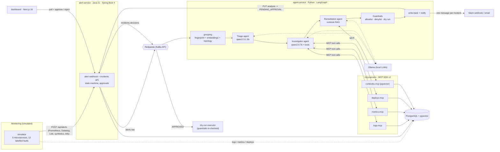

# RootSignal

[](https://github.com/Ramandeep2077/rootsignal/actions/workflows/ci.yml)
[](https://rootsignal-seven.vercel.app)
[](LICENSE)

**An AI incident-response copilot for SRE teams.** When production breaks, monitoring fires dozens of noisy,
duplicated alerts across many services. RootSignal groups them into **one incident**, sends AI agents to
investigate logs, metrics and recent deploys through **MCP tools**, proposes a **runbook-backed fix that a human
must approve**, and sends **one** clear summary instead of an alert storm. An evaluation suite measures accuracy,
speed, cost and guardrail safety on labelled incident scenarios.

**[Live demo](https://rootsignal-seven.vercel.app)**: a read-only snapshot of real evaluation runs, including the
misdiagnoses, each shown next to its ground truth. No install needed.

Everything runs locally for **$0**: open-weight models through Ollama, local embeddings, Redpanda instead of a hosted
Kafka, and LocalStack to validate the AWS deployment.

<!-- RESULTS:START -->
| Metric (routed profile, 12 scenarios x 3 seeds) | Result |
|---|---|
| Root-cause accuracy (exact category) | 66.7% (originating service: 83.3%) |
| Alert noise reduction | 95.0% (1,444 alerts -> 72 incidents; grouping recall/precision 100%) |
| Time to summary (p50) | 191 s on a laptop CPU/iGPU, $0.00 per incident |
| Unsafe actions blocked | 100% (46/46 adversarial, 5/5 tampered, 0 unsafe reached a human under live prompt injection) |

A keyword rules baseline scores higher (100%) on these synthetic scenarios because it was written against the
simulator's log vocabulary; see the caveats in the report for what that does and doesn't mean.

Full results, model comparison and methodology: **[evals/EVALS.md](evals/EVALS.md)**.
<!-- RESULTS:END -->



## How it works



1. **Ingest.** Monitoring tools post alerts to the Java alert service, which validates, fingerprints and stores them,
   then publishes each to Kafka topic `alerts.raw` (after the DB commit).
2. **Group.** The agent service consumes the stream and groups related alerts into one incident by exact
   fingerprint, local MiniLM embedding similarity, and service-dependency adjacency. Low-severity background alerts
   stay separate.
3. **Triage** (small model) titles and prioritises the incident.
4. **Investigate** (larger model): a deterministic evidence pack (top error patterns, metric anomalies, recent
   changes) from the MCP servers, then up to 3 model-chosen MCP tool calls, then a schema-constrained root-cause
   hypothesis with confidence and cited evidence.
5. **Remediate:** pgvector search over the team's runbooks, then one proposed action (action, target, risk, steps,
   rollback) as a Pydantic model.
6. **Guardrails:** allowlist, runbook scope, known targets, destructive-pattern and prompt-injection denylist,
   confidence floor, forced dry run. Any violation becomes `escalate_to_human`.
7. **Human in the loop.** The incident is stored as `PENDING_APPROVAL`; **nothing runs automatically.** One Slack
   message (email fallback) links to the dashboard, where a named human approves or rejects. Approval emits an event
   that runs the action as a **dry run**, after the guardrails check it again.

Everything is traced with OpenTelemetry: one trace per alert from Java through Kafka into Python, and one trace per
incident (linked to its alerts) with LLM and tool spans, viewable in Jaeger and Arize Phoenix.
See [docs/observability.md](docs/observability.md).

## Quickstart

Prerequisites: Docker Desktop, [Ollama](https://ollama.com), [uv](https://docs.astral.sh/uv/), Java 21, Node 22,
GNU make. Tested on Windows 11 (16 GB RAM, no discrete GPU); works on Linux and macOS.

One command (pulls the models on first run, ~6 GB, then builds the stack and fires an incident):

```bash
make demo SCENARIO=bad_deployment
# open http://localhost:3000 -> watch it group, investigate and wait for your approval
```

No Ollama or 16 GB machine? `make demo-lite SCENARIO=bad_deployment` runs the same pipeline (grouping, MCP tools,
guardrails, approval, Slack message, dashboard) with the rules-based investigator instead of the LLMs: no model
download, ~20 s per incident, only Docker, `uv` and `make` needed.

Or step by step: `make models`, `make up`, `make sim SCENARIO=<name>` (the 12 scenarios are listed in
[docs/scenarios.md](docs/scenarios.md)). A narrated walkthrough is in [docs/demo.md](docs/demo.md).

| URL | What |
|---|---|
| http://localhost:3000 | Dashboard (incidents, reasoning trace, approve/reject, metrics) |
| http://localhost:8080/swagger-ui.html | Alert service API (OpenAPI) |
| http://localhost:8090/messages | Mock Slack: the one message per incident |
| http://localhost:8025 | Mailpit: email fallback |
| http://localhost:16686 / :6006 | Jaeger / Phoenix (with `make up-obs`) |

Other targets: `make test` (all suites), `make lint`, `make eval` (evaluation suite), `make sim-all`,
`make up-obs` (with tracing), `make tf-plan` (Terraform against LocalStack), `make down` / `make clean`.

## Repository

| Path | What | Stack |
|---|---|---|
| [`alert-service/`](alert-service) | Alert webhook, incidents API, state machine, approvals, metrics | Java 21, Spring Boot 4.1, JPA, Flyway, Spring Kafka, OpenTelemetry |
| [`agent-service/`](agent-service) | Grouping, triage → investigate → remediate graph, guardrails, notifications, executor | Python 3.12, LangGraph, Pydantic, aiokafka, FastAPI |
| [`mcp-servers/`](mcp-servers) | Read-only logs / metrics / deploys / runbooks tools + 13 runbooks | MCP Python SDK v2, pgvector, fastembed |
| [`simulator/`](simulator) | Seeded simulation of 5 services, alert rules, 12 labelled scenarios | Python |
| [`dashboard/`](dashboard) | Incidents, detail with reasoning trace + approval, metrics | Next.js 16, React 19, Tailwind 4 |
| [`evals/`](evals) | End-to-end harness, LLM-as-judge, guardrail suite, report | Python |
| [`infra/`](infra) | Terraform for AWS (Fargate, RDS, ALB, ECR, Secrets, Budget), validated on LocalStack | Terraform 1.15, AWS provider 6 |
| [`docs/`](docs) | [Design decisions](docs/decisions.md), [scenarios](docs/scenarios.md), [MCP tools](docs/mcp-tools.md), [observability](docs/observability.md), [deployment](docs/deployment.md) | |

## Design decisions and trade-offs

The full log (84 decisions with reasons) is in [docs/decisions.md](docs/decisions.md). The main ones:

- **Why multi-agent?** Triage, investigation and remediation need different context, tools and model sizes.
  Separate agents keep each prompt small (critical on CPU inference, where each prompt token costs ~15 ms), make
  every step inspectable in the reasoning trace, and let each step fall back independently. LangGraph makes the flow
  an explicit state machine that can only end in `PENDING_APPROVAL`, never in an action.
- **Why model routing?** Most incident-handling tokens are cheap work (summarising alert groups); only root-cause
  reasoning needs a bigger model. Routing lives in one file
  ([`models.yaml`](agent-service/config/models.yaml)) with per-agent fallbacks (7B → 1.5B → rules) plus timeouts,
  retries and backoff, so an incident always gets an analysis. The eval compares routed vs small-only vs rules-only.
- **Why human approval?** A wrong automated fix during an outage can be worse than the outage. The agents are
  advisors: the domain state machine allows `APPROVED` only from `PENDING_APPROVAL` via a named human, guardrails run
  before approval and again before execution, and execution is dry-run only. The eval checks that prompt-injected
  unsafe proposals never reach a human.
- **Why MCP?** The tools are reusable across agents and clients (they also work in Claude Desktop/Code over stdio),
  read-only by declaration, and traced end to end with the SDK's own OpenTelemetry middleware.
- **Why a simulator rather than canned alerts?** Alerts emerge from rules evaluated over simulated metrics, with
  failures propagating through the dependency graph, red-herring deploys and background alerts. Noise reduction and
  accuracy are measured on realistic storms, not hand-written lists.
- **Why local models?** $0 to run and reproduce. The cost is latency (minutes per incident on a laptop iGPU), which the
  eval reports honestly. Switching to a hosted frontier model is a config change in `models.yaml`.

## Future improvements

- Transactional outbox for alert → Kafka publishing (today an event can be lost if Kafka is down right after commit).
- Authentication (OIDC) and RBAC on the dashboard and approval endpoints; mTLS between services.
- A live executor with per-action adapters (Kubernetes, feature flags, Terraform) behind the existing guardrails and
  approval flow.
- Learning from history: embed resolved incidents and retrieve similar past incidents as extra evidence.
- Splitting simultaneous independent failures in adjacent services, which today's topology-based grouping would merge.
- Evaluating hosted frontier models (e.g. Claude) against the local models on the same harness, with real token prices.

## License

MIT. See [LICENSE](LICENSE). All data is synthetic; no real company, customer or personal data is used.
