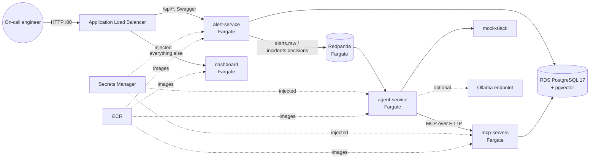

# Deployment

Local development runs entirely in Docker Compose (`make up`). `infra/terraform` describes the same system on AWS.
It can be **validated for free against LocalStack** or deployed for real.

## Architecture on AWS



| Piece | Choice | Why (cost-aware demo) |
|---|---|---|
| Compute | ECS **Fargate Spot**, one task per service | No servers to manage; Spot is much cheaper, and interruptions are fine for a demo |
| Network | VPC with 2 public subnets, **no NAT gateway**; tasks get public IPs; security groups chain ALB → services → DB | A NAT gateway would be one of the largest fixed costs |
| Kafka | **Redpanda as a container** on Fargate | A managed Kafka cluster has a high fixed hourly cost; one small container is enough for a demo |
| Database | RDS PostgreSQL 17 `db.t4g.micro`, 20 GB gp3, single AZ, encrypted, 1-day backups, no deletion protection | Smallest instance; pgvector is available on RDS |
| Entry point | One ALB: `/api/*` → alert-service, default → dashboard | Same origin, so no CORS; a single load balancer |
| Dashboard | Same container as local, on Fargate behind the ALB | The incident page uses a dynamic route, which a static S3 export can't serve without changing URLs; one ALB covers both (deviation from the brief, see D73) |
| Secrets | DB password and internal API token generated by Terraform, stored in Secrets Manager, injected as task secrets | No secrets in images, env files or state outputs |
| LLM | `llm_provider = "mock"` by default (rules-only agents) | GPU instances aren't a $0 demo; point `ollama_base_url` at a model server to use real models |
| Logs | CloudWatch log groups, 7-day retention; Container Insights off | Enough to debug; no extra metric charges |
| Cost guardrail | AWS Budget with e-mail alerts at 80% forecast and 100% actual (default $20/month) | You hear about spend before it surprises you |

Use the [AWS Pricing Calculator](https://calculator.aws/) with these settings for a current estimate. Hourly cost comes
mainly from the ALB, the RDS instance and Fargate vCPU/GB-hours.

## Validate for free with LocalStack

```bash
make aws-local        # starts LocalStack (pinned to 4.14, the last release that runs without an account token)
make tf-plan          # plans the FULL stack (VPC, RDS, ECR, ECS, ALB, Cloud Map, IAM, Secrets, S3, Budget)
make tf-apply-local   # applies the subset LocalStack's free tier emulates: VPC/subnets/SGs, Secrets Manager, S3
make tf-destroy-local
```

ECR, RDS, ECS and ELBv2 are paid LocalStack features, so `localstack.tfvars` switches those modules off for `apply`.
`plan` still exercises them. CI runs `fmt -check`, `validate`, the full `plan`, and an apply/destroy of the free-tier
subset on every pull request.

## Deploy to real AWS

```bash
cp infra/terraform/aws.tfvars.example infra/terraform/aws.tfvars   # set your IP, budget e-mail
make aws-deploy      # creates ECR, builds + pushes the 4 images (linux/amd64), applies everything, prints the URL
make aws-destroy     # destroys everything, then lists any tagged resource that is still around
```

Teardown is designed to leave nothing billable behind: `skip_final_snapshot`, ECR `force_delete`, S3
`force_destroy`, and Secrets Manager `recovery_window_in_days = 0`.

## Production hardening (not done for the demo)

HTTPS on the ALB with an ACM certificate and a domain; private subnets with a NAT gateway or VPC endpoints;
Multi-AZ RDS with longer backups and deletion protection; a managed Kafka (MSK) cluster with persistent storage;
SSO/OIDC on the dashboard and approval endpoints; remote Terraform state (S3 + DynamoDB lock); autoscaling.
