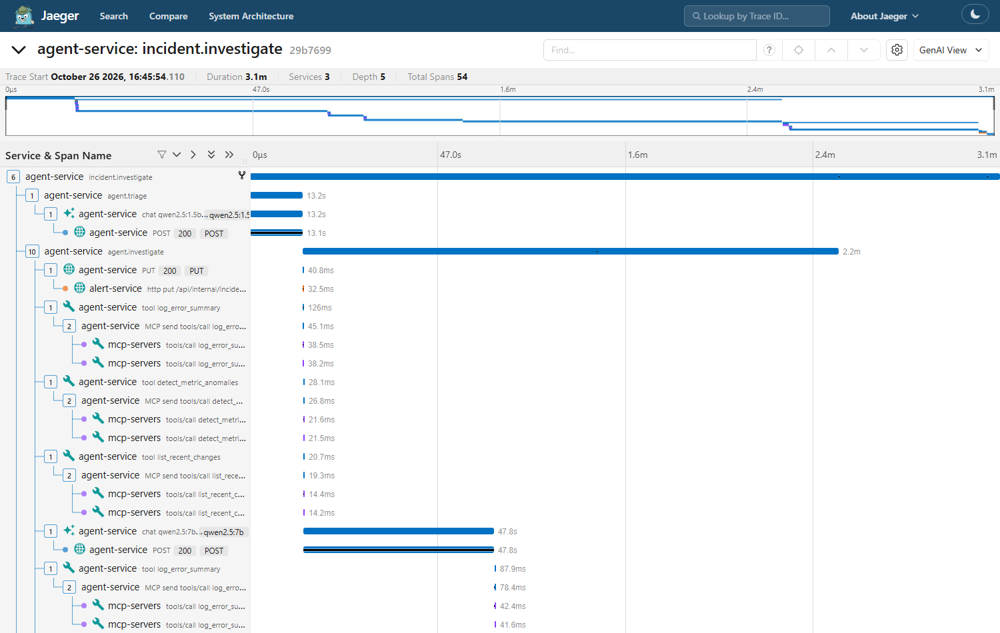

# Observability

Two complementary views, both local and free:

| Tool | URL | Shows |
|---|---|---|
| **Jaeger** (OpenTelemetry) | http://localhost:16686 | Distributed traces across Java, Kafka, Python agents, MCP servers and Ollama calls |
| **Arize Phoenix** | http://localhost:6006 (project `oncall-copilot`) | LLM-centric view of the same spans: agent → chain → LLM/tool hierarchy, prompts and outputs, token counts, latency |

Tracing is **off by default** (zero overhead and no exporter errors when Jaeger isn't running). Turn it on with:

```bash
make up-obs        # full stack + Jaeger + Phoenix, with OTEL_TRACES_EXPORTER=otlp and ONCALL_TRACING_EXPORT=true
```

## What a trace looks like



**Alert ingestion: one trace per alert, Java → Kafka → Python**

```
alert-service  http post /api/alerts
alert-service    alerts.raw send                 (Spring Kafka observation; injects traceparent header)
agent-service      alerts.raw process            (aiokafka consumer extracts traceparent from record headers)
```

**Incident investigation: one trace per incident, *linked* to the traces of every alert it grouped**

```
agent-service  incident.investigate            AGENT  links -> N alert traces; status, tokens, cost
agent-service    agent.triage                  CHAIN
agent-service      chat qwen2.5:1.5b           LLM    llm.token_count.*, input/output
agent-service    agent.investigate             CHAIN
alert-service      http put .../status
agent-service      tool log_error_summary      TOOL   arguments / compact result
mcp-servers          tools/call log_error_summary     (MCP SDK server span; context sent in the MCP request _meta)
agent-service      chat qwen2.5:7b             LLM
agent-service    agent.remediate / agent.guardrails / agent.persist / agent.notify
alert-service      http put .../analysis, http post .../notified
```

An incident groups many alerts, so it can't have one parent. Span **links** connect it to all of them, which is the
OpenTelemetry pattern for many-to-one batch processing.

## How it's wired

- **Java** (`alert-service`): `spring-boot-starter-opentelemetry` (Micrometer Tracing → OTel → OTLP/HTTP).
  `spring.kafka.template.observation-enabled=true` adds producer spans and W3C `traceparent` headers to records.
  Spans are always created (so propagation works); export is controlled by `ONCALL_TRACING_EXPORT`.
- **Python** (`oncall_common.telemetry`): OTel SDK with OTLP/HTTP exporters to Jaeger and (agent service) Phoenix;
  `httpx` auto-instrumentation propagates context to the alert service, MCP servers and Ollama. Manual spans use
  **OpenInference** attributes (`openinference.span.kind`, `llm.model_name`, `llm.token_count.*`, `input.value`,
  `output.value`) plus the **GenAI semantic conventions** (`gen_ai.request.model`, `gen_ai.usage.*`), so both
  Phoenix and Jaeger's GenAI view understand them.
- **MCP**: the SDK's own `OpenTelemetryMiddleware` creates server spans; the agent puts its trace context into
  each request's `_meta` (the MCP convention), so tool executions nest under the calling agent span.
- A root sampler drops container health-check requests, so traces stay readable.

## Cost and token tracking without tracing

Token counts, latency and estimated cost per model call are recorded with every incident whether or not tracing is on
(`llmUsage` on the incident, shown on the dashboard's incident page and metrics page). Local models are priced at
$0 in `agent-service/config/models.yaml`; add real prices there to cost a hosted model.
